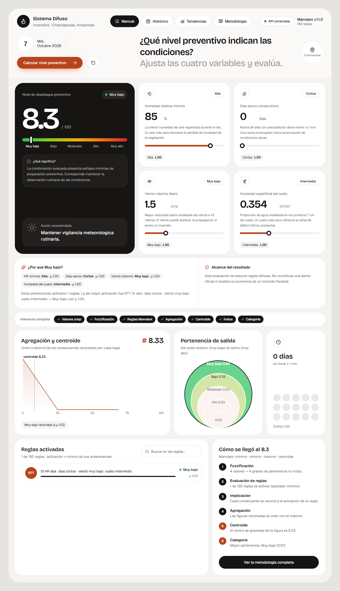
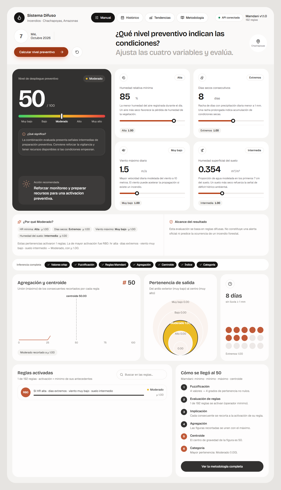
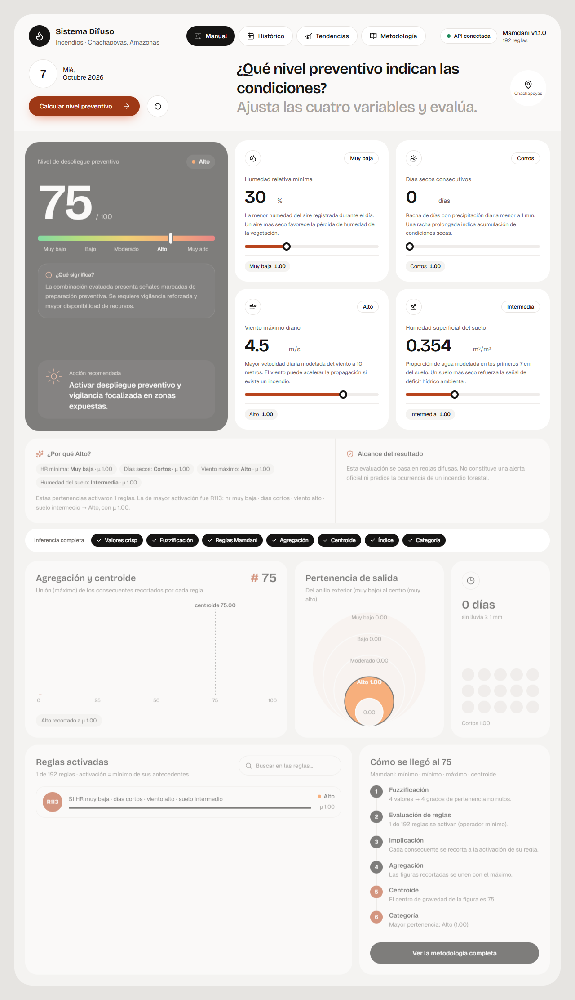
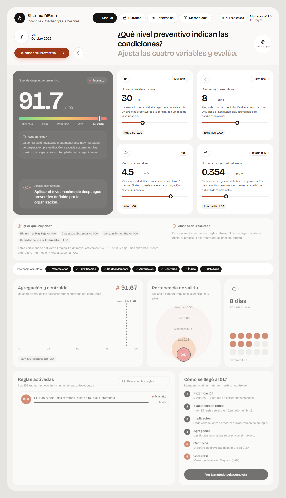

# Cuatro corridas oficiales

Estas corridas fueron ejecutadas desde la interfaz web contra la API real. Verifican el comportamiento esperado del software; no constituyen validación contra incendios observados.

## Muy bajo

| Elemento | Valor |
|---|---|
| HR mínima | 85 % |
| Días secos | 0 |
| Viento máximo | 1.5 m/s |
| Humedad superficial del suelo | 0.354 m³/m³ |
| Índice | 8.33 / 100 |
| Categoría | Muy bajo |
| Recomendación | Mantener vigilancia meteorologica rutinaria. |

**Pertenencias dominantes:** HR mínima = Alta (μ 1.00); Días secos = Cortos (μ 1.00); Viento máximo = Muy bajo (μ 1.00); Humedad superficial del suelo = Intermedia (μ 1.00).

**Regla más activa:** R77, consecuente Muy bajo, activación μ 1.00.

## Moderado

| Elemento | Valor |
|---|---|
| HR mínima | 85 % |
| Días secos | 8 |
| Viento máximo | 1.5 m/s |
| Humedad superficial del suelo | 0.354 m³/m³ |
| Índice | 50 / 100 |
| Categoría | Moderado |
| Recomendación | Reforzar monitoreo y preparar recursos para una activacion preventiva. |

**Pertenencias dominantes:** HR mínima = Alta (μ 1.00); Días secos = Extremos (μ 1.00); Viento máximo = Muy bajo (μ 1.00); Humedad superficial del suelo = Intermedia (μ 1.00).

**Regla más activa:** R80, consecuente Moderado, activación μ 1.00.

## Alto

| Elemento | Valor |
|---|---|
| HR mínima | 30 % |
| Días secos | 0 |
| Viento máximo | 4.5 m/s |
| Humedad superficial del suelo | 0.354 m³/m³ |
| Índice | 75 / 100 |
| Categoría | Alto |
| Recomendación | Activar despliegue preventivo y vigilancia focalizada en zonas expuestas. |

**Pertenencias dominantes:** HR mínima = Muy baja (μ 1.00); Días secos = Cortos (μ 1.00); Viento máximo = Alto (μ 1.00); Humedad superficial del suelo = Intermedia (μ 1.00).

**Regla más activa:** R113, consecuente Alto, activación μ 1.00.

## Muy alto

| Elemento | Valor |
|---|---|
| HR mínima | 30 % |
| Días secos | 8 |
| Viento máximo | 4.5 m/s |
| Humedad superficial del suelo | 0.354 m³/m³ |
| Índice | 91.67 / 100 |
| Categoría | Muy alto |
| Recomendación | Aplicar el nivel maximo de despliegue preventivo definido por la organizacion. |

**Pertenencias dominantes:** HR mínima = Muy baja (μ 1.00); Días secos = Extremos (μ 1.00); Viento máximo = Alto (μ 1.00); Humedad superficial del suelo = Intermedia (μ 1.00).

**Regla más activa:** R116, consecuente Muy alto, activación μ 1.00.

